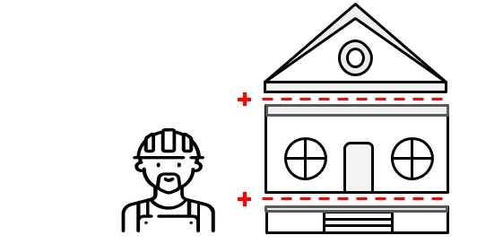
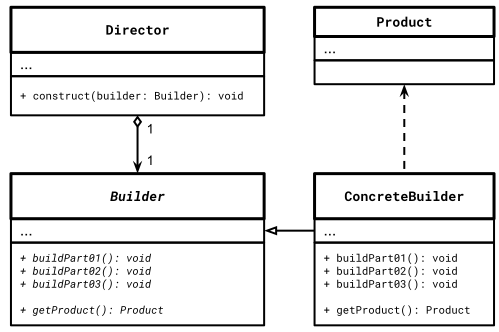

# Builder Pattern

[Zurück](../../../Resources/Readme_05_Catalog.md)

---



<sup>(Credits: [Blog von Vishal Chovatiya](https://vishalchovatiya.com/pages/start-here/))</sup>

---

## Wesentliche Merkmale

##### Kategorie: Erzeugungsmuster / *Creational Pattern*

###### In einem Satz:

> &bdquo;Das Builder Pattern trennt die schrittweise Konstruktion eines komplexen Objekts von seiner Repräsentation, sodass derselbe Konstruktionsprozess unterschiedliche Ausprägungen des Objekts erzeugen kann.&rdquo;

Das *Builder Pattern* gehört zu den Erzeugungsmustern (*Creational Patterns*).
Es kommt insbesondere dann zum Einsatz, wenn ein Objekt aus vielen optionalen oder voneinander abhängigen Bestandteilen besteht.
Anstatt einen Konstruktor mit einer großen Anzahl von Parametern zu verwenden,
wird das Objekt schrittweise über einen sogenannten *Builder* aufgebaut.

Das *Builder*-Objekt kapselt die einzelnen Bauschritte über klar benannte Methoden.
Ein sogenannter *Director* kann diese Schritte in einer bestimmten Reihenfolge aufrufen,
ist dabei aber selbst unabhängig davon, wie das fertige Produkt konkret aussieht.

Dadurch lässt sich derselbe Bauprozess wiederverwenden, um verschiedene Varianten oder Repräsentationen eines Objekts zu erzeugen.

Der Client muss die internen Details der Konstruktion nicht kennen und erhält am Ende nur das fertige, konsistente Produkt.

In C++ wird das Pattern häufig mit *Method Chaining* (*Fluenten* Buildern) kombiniert,
bei denen jede *setter*-ähnliche Methode eine Referenz auf den Builder zurückgibt.

So entsteht ein lesbarer, deklarativer Konstruktionsablauf, der sowohl Robustheit als auch Flexibilität in der Objekterzeugung fördert.

---

#### Conceptual Example:

[Quellcode 1 &ndash; Sehr einfache Version](../ConceptualExample.cpp)<br />
[Quellcode 2 &ndash; Fluent Programming Style mit einem PersonBuilder](../PersonBuilderExample.cpp)<br />
[Quellcode 3 &ndash; Ein Raubüberfall](../Heist.cpp)<br />

---

#### Struktur (UML):

Das folgende UML-Diagramm beschreibt eine Implementierung des *Builder Patterns*.
Es besteht im Wesentlichen aus vier Teilen:

  * **Product**: Klasse, die das komplexe Objekt repräsentiert, das zu erstellen ist.
  * **Builder**: Abstrakte Basisklasse (oder Schnittstelle) für `Builder`-Objekte. Es werden die Schritte definiert,
    die ausgeführt werden müssen, um ein komplexes Objekt (Produkt) korrekt zu erstellen.
    Typischerweise ist jeder Schritt eine abstrakte Methode, die durch eine konkrete Implementierung überschrieben wird.
  * **ConcreteBuilder**: Stellt eine Implementierung der `Builder`-Schnittstelle bereit. Ein `Builder`-Objekt ist ein Objekt,
    das andere komplexe Objekte ("Produkte") erstellen kann.
  * **Director**: Stellt die Klasse dar, die den Algorithmus steuert, der zum Erstellen des komplexen Objekts verwendet wird.



*Abbildung* 1: Schematische Darstellung des *Builder Patterns*.

---

#### Ein erstes &bdquo;Real-World&rdquo; Beispiel: Fluent Builder

*Bemerkung*:<br />
Diese Anwendung des Builder Patterns wird auch als &bdquo;Named Arguments in C++&rdquo; bezeichnet.

Wir betrachten nun ein Beispiel, in dem eine Klasse (Klasse `Person`)
viele Daten (hier: zur Person und zum Beruf) haben kann.

Natürlich könnte man dies alles mit einer einzigen Klasse (hier: `Person`)
über unterschiedliche Konstruktoren und *setter*-Methoden abhandeln.
Bei einer Klasse mit sehr vielen Instanzvariablen kann dies bisweilen 
unübersichtlich werden:

```cpp
01: class Person
02: {
03: private:
04:     // personal details
05:     std::string m_name;     
06:     std::string m_street_address;
07:     std::string m_post_code;
08:     std::string m_city;
09:     std::string m_country;
10: 
11:     // employment details
12:     std::string m_sector;
13:     std::string m_company_name;
14:     std::string m_position;
15: 
16:     Person(const std::string& name) : m_name{ name } {}
17: };
```

Anstatt all diese konstruktionsbezogenen Methoden (Konstruktoren, *setter*-Methoden)
der Klasse `Person` hinzuzufügen,
delegieren wir diese Aufgabe an eine separate Klasse &ndash; wir nennen sie `PersonBuilder`.

Studieren Sie den Quellcode der Klasse `PersonBuilder` genau:
Indem der Konstruktor der Klasse `Person` privat deklariert ist,
zwingen wir Benutzer der Klasse `Person`, die
`PersonBuilder`-Klasse zu verwenden.
Es ist nur die `create(const std::string& name)`-Schnittstellenmethode an der Klasse
`Person` verfügbar.

Betrachten Sie den folgenden Quellcode:
Es wird der so genannte &bdquo;*Fluent Builder*&rdquo; Programmierstil demonstriert:

```cpp
Person p{ Person::create("Jack")
    .lives("Great Britain")
    .at("17 Sloane Street")
    .with_postcode("SW1X 9NU")
    .in("London")
    .works("Information Technology")
    .with("Software Manufactur")
    .as_a("Consultant")
};
```

---

#### Ein zweites &bdquo;Real-World&rdquo; Beispiel: Ein Raubüberfall

Hier ist ein Beispiel für einen &bdquo;Builder&rdquo; im Raubüberfall-Stil:

Der Builder berechnet die Erfolgswahrscheinlichkeit eigenständig auf Basis von Sicherheitsstufe, Crew, Ausrüstung und Tarnung.
Die Werte sind beispielhaft gewählt (46 %, 40 % und 43 % in der Demo) &ndash; man kann
die Formel also gerne anpassen, wenn du für mehr Spannung sorgen möchtest.

Möchte man das Ganze noch weiter ausbauen möchtest, wäre ein nächster Schritt,
den Builder wieder als abstraktes Interface zu gestalten &ndash; etwa mit einem `StealthHeistBuilder` und einem `LoudHeistBuilder`,
die denselben Plan jeweils auf unterschiedliche Weise zusammenstellen.

Damit greift man auf das polymorphe *Builder*-Konzept aus deinem ersten Beispiel zurück,
verleiht ihm nun aber einen konkreten Daseinszweck.

---

## Literaturhinweise

Die Anregungen zum konzeptionellen Beispiel finden Sie unter

[https://refactoring.guru/design-patterns](https://refactoring.guru/design-patterns/builder/cpp/example#example-0)

vor.

Das &bdquo;Real-World&rdquo;-Beispiel ist eine Portierung eines entsprechenden C#-Beispiels aus dem Buch von Matthias Geirhos,
siehe dazu das [Literaturverzeichnis](../../../Resources/Readme_07_Literature.md).

---

[Zurück](../../../Resources/Readme_05_Catalog.md)

---
