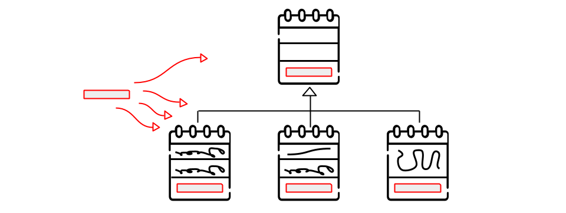
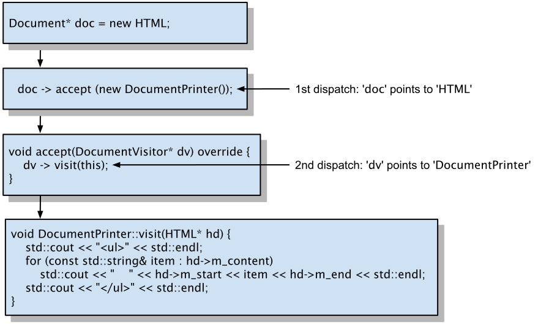

# Visitor Pattern

[Zurück](../../../Resources/Readme_05_Catalog.md)

---



<sup>(Credits: [Blog von Vishal Chovatiya](https://vishalchovatiya.com/pages/start-here/))</sup>

---

## Wesentliche Merkmale

#### Kategorie: *Behavioral Pattern*

#### Ziel / Absicht:

###### In einem Satz:

> &bdquo;Das Visitor Pattern ermöglicht es, neue Operationen auf einer bestehenden Objektstruktur hinzuzufügen, ohne die Klassen dieser Struktur selbst verändern zu müssen.&rdquo;

Das *Visitor Pattern* gehört zur Kategorie der Verhaltensmuster (Behavioral Patterns) und löst ein häufiges Problem objektorientierter Systeme:
Man hat eine heterogene Struktur von Objekten &ndash; etwa einen Syntaxbaum, eine Dokumentstruktur oder eine Sammlung
geometrischer Figuren &ndash; und möchte immer wieder neue Operationen auf diesen Objekten ausführen,
ohne jedes Mal deren Klassen anzufassen.

Statt die Operation direkt in den Elementklassen zu implementieren, wird sie in ein separates Visitor-Objekt ausgelagert,
das für jeden konkreten Elementtyp eine passende `visit()`-Methode bereitstellt.
Die Elementklassen selbst benötigen dafür lediglich eine `accept()`-Methode, die den Visitor entgegennimmt
und sich selbst an ihn übergibt &ndash; ein Mechanismus, der als *Double Dispatch* bekannt ist, da zur Laufzeit
sowohl der konkrete Typ des Elements als auch der des Visitors über die auszuführende Methode entscheiden.

Dieser Ansatz macht es sehr einfach, neue Operationen hinzuzufügen:
Man schreibt einfach eine neue Visitor-Klasse, ohne die bestehende Objektstruktur zu verändern.

Der Preis dafür ist, dass das Hinzufügen eines neuen Elementtyps aufwendig wird,
da dann alle existierenden Visitor-Implementierungen angepasst werden müssen.

Das Pattern eignet sich daher besonders für Szenarien, in denen die Objektstruktur stabil bleibt,
aber die Menge der darauf ausgeführten Operationen häufig wächst.

---

#### Conceptual Example:

[Quellcode 1 &ndash; mit Vererbung](../ConceptualExample.cpp)<br />
[Quellcode 2 &ndash; mit `std::variant`](../ConceptualExample_Variant_Visit.cpp)

---

#### Struktur (UML):

Das folgende UML-Diagramm beschreibt eine Implementierung des *Visitor Patterns*.
Es besteht im Wesentlichen aus sechs Teilen:

  * **Client**: Anwender des *Visitor Patterns*. Er verwaltet die Objektstruktur und weist die Objekte innerhalb der Struktur an,
    wann ein Besucher akzeptiert werden soll.
  * **ObjectStructure**: Dies ist eine Klasse, die alle Objekte enthält, die besucht werden können.
    Es bietet einen Mechanismus zum Traversieren aller Elemente.
    Diese Struktur muss nicht zwingend eine *Collection* sein, es kann irgend eine komplexe Struktur sein, beispielsweise ein *Composite Object*.
  * **ElementBase**: Stellt eine Abstraktionsschnittstelle dar, die die `accept`-Operation deklariert. Dies ist der Einstiegspunkt, an dem ein Objekt vom Besucherobjekt &bdquo;besucht&rdquo; werden kann.
    Jedes Objekt aus einer *Collection* sollte diese Abstraktionsschnittstelle implementieren, um besucht werden zu können.
  * **ConcreteElement**: Diese Klassen erben von der abstrakten Basisklasse `ElementBase` oder implementieren eine Schnittstelle
    und definieren eine `accept`-Operation. Das *Visitor*-Objekt wird durch die `accept`-Operation an dieses Objekt übergeben.
  * **VisitorBase**: Deklariert eine `visit`-Methode (Operation) für jede Klasse von `ConcreteElement` in der Objektstruktur.
    Der Name und die Signatur der Operation identifizieren die Klasse, die die Anforderung an den Visitor sendet.
    Auf diese Weise kann der Besucher die konkrete Klasse des besuchten Elements bestimmen.
    So kann der Besucher direkt über diese spezielle Schnittstelle auf die fraglichen Elemente zugreifen.
  * **ConcreteVisitor**: Implementiert jede von einem Visitor deklarierte Operation (Methode).
    Jede Operation implementiert ein Fragment eines Algorithmus, der für die entsprechende Klasse oder das entsprechende Objekt in der Objektstruktur definiert ist.
    `ConcreteVisitor` stellt den Kontext für den Algorithmus bereit und speichert seinen lokalen Status.
    Dieser Zustand sammelt häufig Ergebnisse während des Durchlaufens der Struktur.


*Abbildung* 1: Schematische Darstellung des *Visitor Patterns*.

---

### Zusammenspiel von Composite Pattern und Visitor Pattern

Das Zusammenspiel von *Composite Pattern* und *Visitor Pattern* wird am Beispiel des Traversierens einer Verzeichnisstruktur
aufgezeigt. In einer ersten Realisierung wird das Visitor Pattern über eine gemeinsame Basisklasse und virtuelle `accept()`-Methoden
ausgedrückt.

In einer zweiten Realisierung entfallen diese Werkzeuge zu Gunsten von `std::variant`.

Für das Beispiel bietet sich folgende Struktur an:

  * Die Klassen `File` und `Directory` sind normale, unabhängige Klassen.
  * Der Typ `FileSystemElement` ist ein `std::variant<File, Directory>`.
  * Die Klasse `Directory` enthält einen Member `std::vector<FileSystemElement>`.
  * Der Visitor ist kein Objekt mehr, das von einer Visitor-Basisklasse erbt, sondern ein aufrufbares Objekt, das eine geeignete Menge
	von Überladungen des Aufrufoperators `operator()` besitzt.
  * Die dynamische Auswahl übernimmt `std::visit`.

Ein wichtiger Punkt ist allerdings die Rekursion: `Directory` enthält wiederum `FileSystemElement`, das `Directory` enthalten kann.
Ein `std::variant<File, Directory>` kann nicht direkt verwendet werden, solange `Directory` den Variant-Typ selbst *by value* enthält.

Deshalb ist es sinnvoll, die Kinder weiterhin über `std::unique_ptr` zu halten oder einen rekursiven Wrapper einzuführen.

Damit können wir nun die folgenden zwei Ansätze unterscheiden:

Klassisches C++:

```cpp
IFileComponent
   |
   +-- File
   |
   +-- Directory
          |
          +-- unique_ptr<IFileComponent>
          +-- unique_ptr<IFileComponent>
```

Modern C++:

```cpp
FileSystemElement = variant<File, unique_ptr<Directory>>

Directory
   |
   +-- vector<FileSystemElement>
```


Die ursprünglicher Visitor-Klasse wird auf diese Weise überhaupt nicht mehr benötigt.

Wir schreiben stattdessen eine Klasse mit mehreren Überladungen des Aufrufoperators `operator()`:

```cpp
01: class SizeVisitor
02: {
03: public:
04:     void operator()(const File& file)
05:     {
06:         m_totalSize += file.size();
07:     }
08: 
09:     void operator()(const std::unique_ptr<Directory>& directory)
10:     {
11:         for (const auto& child : directory->children()) {
12:             std::visit(*this, child);
13:         }
14:     }
15: 
16:     [[nodiscard]]
17:     std::size_t totalSize() const noexcept { return m_totalSize; }
18: 
19: private:
20:     std::size_t m_totalSize{};
21: };
```

---

#### Erstes &bdquo;Real-World&rdquo; Beispiel:

Wie wir sehen, haben wir es in der Realisierung des Patterns mit zwei Ebenen der Indirektion zu tun.
Damit wurde vor allem vermieden, die zwei Prinzipien
*Open*-*Closed-Principle* und *Single*-*Responsibility-Principle* zu verletzen.

Hierfür gibt es ein spezielles Schlagwort: *Double Dispatch*, siehe dazu auch *Abbildung* 2:



*Abbildung* 2: Schematische Darstellung des *Double Dispatch*&ndash;Idioms.

Über das Objekt `doc` rufen wir die Methode `accept()` auf:

```cpp
doc -> accept (new DocumentPrinter());
```

Diese delegiert auf Grund des virtuellen Methodenaufrufmechanismus den Aufruf an die Methode `HTML::accept`.
Im Kontext dieser Methode finden wir wiederum einen Aufruf

```cpp
dv->visit(this);
```

vor. Dieses Mal wird &ndash; auf Grund des virtuellen Methodenaufrufmechanismus &ndash; 
der Aufruf an die Methode `DocumentPrinter::visit(HTML*)` delegiert (unter Berücksichtigung
des Zeigertyps `HTML*`).

---

#### Ein weiteres &bdquo;Real-World&rdquo; Beispiel:

Das *Visitor*-Entwurfsmuster lässt sich in *Modern C++* mit `std::variant` und `std::visit` sehr einfach umsetzen.

Hierbei gilt es eine Besonderheit zu betrachten:
Wir können mit der C++-Template-Technik die Realisierung so gestalten,
dass wir auf den virtuellen Methodenaufrufmechanismus **nicht** angewiesen sind!
Bei der klassischen Umsetzung des Musters ist dieser vorhanden.

Wir betrachten eine Buchhandlung (Klasse `Bookstore`), die Bücher und DVDs (Klassen `Book` und `Movie`) verkauft. 

```cpp
class Book
{
  ...
};

class Movie
{
  ...
};
```

1. *Frage*:
Wie ist die Schnittstelle eines Konstruktors für die `Bookstore`-Klasse zu definieren,
wenn dieser `Book`- und `Movie`-Objekte gemischt in einem `std::vector`-Objekt aufnehmen kann?

```cpp
Book cBook { "C", "Dennis Ritchie", 11.99, 12 };
Book javaBook{"Java", "James Gosling", 17.99, 21 };
Book cppBook{"C++", "Bjarne Stroustrup", 16.99, 4 };
Book csharpBook{"C#", "Anders Hejlsberg", 21.99, 8 };

Movie movieTarantino{ "Once upon a time in Hollywood", "Quentin Tarantino", 6.99, 3 };
Movie movieBond{ "Spectre", "Sam Mendes", 8.99, 6 };

using MyBookstore = Bookstore<Book, Movie>;

MyBookstore bookstore = MyBookstore {
    cBook, movieBond, javaBook, cppBook, csharpBook, movieTarantino
};
```

Entwerfen Sie drei rudimentäre Klassen `Book`, `Movie` und `Bookstore`,
um das gezeigte Code-Fragment übersetzen zu können.


2. *Frage*:
Wie ist in der Klasse `Bookstore` eine Methode `totalBalance` zu implementieren, um den Gesamtwert des Warenbestands in
der Buchhandlung zu berechnen? Hier könnten `std::variant` und `std::visit` zum Einsatz gelangen.

```cpp
double balance = bookstore.totalBalance();
std::cout << "Total value of Bookstore: " << balance << std::endl;
```

Noch ein Hinweis:

Die `std::visit`-Funktion hat als ersten Parameter ein *Callable* (Funktor, generisches Lambda),
um auf das `std::variant`-Objekt zugreifen zu können. Im `std::variant`-Objekt wiederum kann &ndash; in unserer Betrachtung &ndash;
ein `Book`- oder ein `Movie`-Objekt enthalten sein. Wenn diese Klassen
eine Methode desselben Namens (derselben Schnittstelle) enthalten,
wie zum Beispiel `getPrice` oder `getCount`, dann haben Sie das Ziel fast schon erreicht.

*Zusatzaufgabe*:
Realisieren Sie eine Methode `addMedia`, die ein beliebiges &bdquo;Media&rdquo;-Objekt einem `Bookstore`-Objekt hinzufügen kann.
Natürlich muss der Datentyp des &bdquo;Media&rdquo;-Objekts (also z.B. `Book` oder `Movie`) für das `Bookstore`-Objekt
bereits bekannt sein:

```cpp
Book csharpBook{ "C#", "Anders Hejlsberg", 21.99, 1 };
bookstore.addMedia(csharpBook);
```

---

#### Ein drittes &bdquo;Real-World&rdquo; Beispiel:

Im Buch [Entwurfsmuster: Das umfassende Handbuch](https://www.amazon.de/Entwurfsmuster-umfassende-Handbuch-Matthias-Geirhos/dp/3836227622)
von Matthias Geirhos findet sich zu diesem Entwurfsmuster ein Beispiel aus der Welt des Onlinehandels vor.
Sagen wir, ein Onlinehändler würde Bücher, Spiele und Videos verkaufen.
Das ist nichts Neues, und ein Warenkorb mit Büchern, Spielen und Videos stellt auch keine große Herausforderung dar.

Nun aber kommen die Methoden ins Spiel. Mit den Elementen eines Warenkorbs kann man sehr unterschiedliche Dinge anstellen wie zum Beispiel:

  * Berechnung des Gesamtpreises aller Artikel im Warenkorb,
  * Zusammenstellung des Inhalts des Warenkorbs als HTML für die Website des Onlinehandels,
  * Erstellung einer Rechnung zum Inhalt des Warenkorbs als PDF,
  * ...

Und natürlich gibt es noch viele Methoden, die nur einzelnen Klassen (`Buch`, `Spiel`, ...) vorbehalten sind.

Damit sind wir im Zentrum des Musters angekommen: Es trennt die Klassenhierarchie von den Operationen, die
stattdessen in eine zweite Hierarchie wandern. Und anstatt die Operation direkt aufzurufen,
erstellen wir ein Objekt für diese auszuführende Operation (den so genannten *Visitor*) und übergeben es
dem Objekt der fachlichen Hierarchie (der so genannten *ObjectStructure*),
die dann die Operation aufruft.

Studieren Sie den Beispielcode aus dem Buch und führen Sie diesen in ein C++-Programm über. Betrachten Sie hierzu auch *Abbildung* 2:


*Abbildung* 3: Ein Onlinehandel modelliert mit dem *Visitor Pattern*.

Studieren Sie die Realisierung der zwei *Visitor*-Klassen, eine für die Berechnung des Gesamtpreises aller Artikel im Warenkorb und eine weitere
zur Darstellung des Inhalts des Warenkorbs in HTML.

Implementieren Sie zwei weitere *Visitor*-Klassen: Eine namens `CountVisitor`, die einfach die Anzahl aller Artikel im Warenkorb bestimmt.
Und eine zweite Klasse `TextVisitor`, die den Inhalt des Warenkorbs in textueller Form für eine Versandbestätigung zusammenstellt.

---

## Weiterarbeit:

Eng verwandt mit dem  *Visitor Pattern* ist das  *Double Dispatch* Pattern. Siehe hierzu

[Visitor and Double Dispatch](https://refactoring.guru/design-patterns/visitor-double-dispatch)

und 

[Double Dispatch in C++](https://vishalchovatiya.com/posts/double-dispatch-in-cpp/)

---

## Literaturhinweise

Die Anregungen zum konzeptionellen Beispiel finden Sie unter

[https://refactoring.guru/design-patterns](https://refactoring.guru/design-patterns/visitor/cpp/example#example-0)

vor.

---

[Zurück](../../../Resources/Readme_05_Catalog.md)

---
